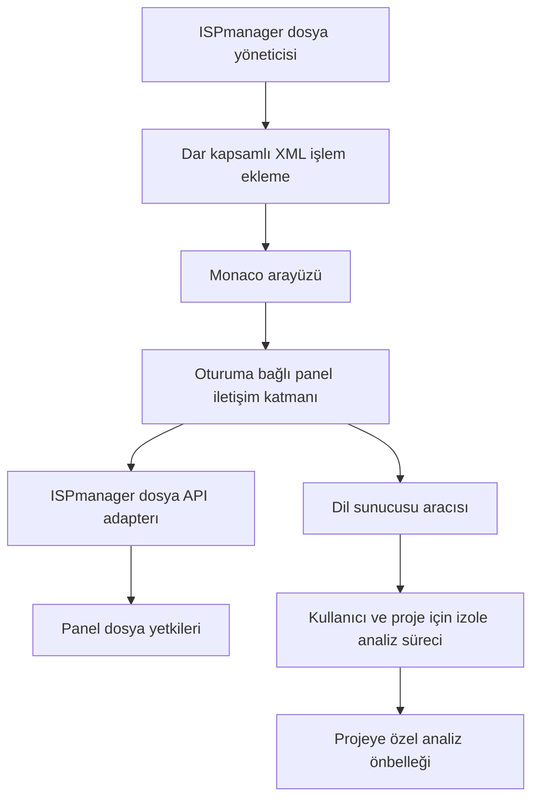

# ISPmanager Monaco Editor mimarisi

## Amaç ve kararların durumu

Plugin 0.3.0 site notu, çalışan editör 0.2.5'ten ayrı XML handler ve ayrı root yapılandırma dosyasıdır. Yalnızca yetkili `site.edit` formunun Ana ayarlar sayfasına native bilgi/uyarı banner'ı ekler. Root ayar sayfası mevcut editör ayarlarına not türü ve metni ekler; dosya erişimi veya IP seçimini değiştirmez. Eski editör payload'u aynen korunur. [Uygulanan kapsam, hata sınırları ve testler](PLUGIN_0_3_0.md).

Monaco arayüzü, ISPmanager entegrasyonu ve proje analizi birbirinden ayrılır. Dosya erişiminin yetki kaynağı ISPmanager olarak kalır. PHP/Laravel analizi için ayrı ve kaynakları sınırlanmış dil sunucuları kullanılır. Bu belge hedef tasarımdır; oturum aktarımı, güvenli kaydetme ve sandbox ayrıntıları Faz 0 deneyleri tamamlanınca kesinleşir.

## Belgelenmiş entegrasyon noktaları

ISPmanager'ın event mekanizması mevcut ekranın XML tanımına işlem veya alan eklemeye izin verir. İlk pilot, standart `file.edit` sonrasında yetkilendirilmiş yanıta salt okunur Monaco alanı ekler; native düzenleme/kaydetme formunu korur. Nihai düzenlenebilir Monaco akışı ayrıca doğrulanır. Eklenti adı ve alanları başka eklentilerle çakışmayacak bir ad alanında tutulur. [XML ve event belgeleri](https://www.ispmanager.com/docs/developer-guide/xml-description-of-pages)

Panel içinde frame ile özel arayüz gösterilebilir. Bu destek, oturumun frame'e güvenle aktarılacağını veya frame'in güvenlik izolasyonu sağlayacağını tek başına kanıtlamaz. [Frame belgesi](https://www.ispmanager.com/docs/developer-guide/add-a-custom-frame-to-the-panel-interface)

0.1.2 pilot kararı: native Phoenix form renderer'ının `htmldata` alanını işlemediği gerçek arayüz kaynağından doğrulandı; desteklenen `frame` kullanılır. Ayrı dosya API'si veya oturum taşıması açılmaz. Frame yalnızca kendi `isp-new-dynamic-form` atası altındaki tek `fdata-code-element` Ace editörünün `getValue()` API'sinden bir kopya okur. Bu dar, sürüme bağlı DOM okuma adapter'ı native DOM'u/modeli değiştirmez; global editör araması, Angular servisine erişim, token/storage okuma, mesajlaşma veya istek yoktur. Yanlış/çift alan, kopan form, boyut aşımı veya 5 saniyelik readiness süresi aşımında Monaco açılmaz, native form korunur. Frame URL'si statik yol ve yalnızca yeniden yükleme amaçlı public nonce içerir; dosya/oturum verisi içermez. Aynı origin frame origin izolasyonu sayılmaz. Önceki `srcdoc` yolu bırakılmıştır. Ayrıntılar ve geri dönüş [pilot kurulum belgesindedir](MONACO_ONIZLEME_KURULUM.md).

0.2.0 uygulama kararı: kullanıcı 0.1.2 render'ını gerçek ekran görüntüsüyle doğruladı. Yeni `editor-bridge` yalnızca bu frame'in aynı formundaki doğrulanmış Ace modelini `setValue` ile günceller. Native Angular change yolu ve mevcut Kaydet/CSRF/yetki denetimi korunur; bağımsız dosya endpoint'i yoktur. Native kod alanı ancak hazır Monaco ve eşleşen Kaydet metadata'sı doğrulandıktan sonra gizlenir. Hata durumunda native alan geri gelir; uyuşmayan bekleyen tamponla kaydetme engellenir. Native encoding/reload değişiklikleri döngüsüz biçimde Monaco'ya aktarılır. Bu sürüm native eşzamanlı yazma semantiğini devralır; aşağıdaki daha güçlü CAS/izolasyon maddeleri hedef tasarımdır ve sağlanmış kabul edilmez. [Uygulanan kapsam ve sınırlar](EDITOR_0_2_0.md).

Sunucu varsayılanları root-only native `ismonaco.settings` formundan, sabit root:root 0600 dosyasına şema doğrulaması ve atomik değiştirmeyle kaydedilir. Frame URL fragment'inde yalnızca public görünüm ayarları, kontrol adları ve menü görünürlüğü bulunur; bunlar kimlik/yetki kaynağı değildir. Geçerli ayarlar bütün kullanıcıların yeni açılan editörlerine uygulanır. Tarayıcı depolaması kullanılmaz.

0.2.1 düzeltmesi: frame native kod alanının hemen önüne yerleştirilir; filename/encoding sırası korunur. Native modda yalnızca bir geçiş çubuğu açık kalır; dönüşte aynı Ace kimliği doğrulanıp en güncel native tampon Monaco'ya alınır, native modele geri yazılmaz. Ayar GET yanıtı kendi metadata/messages ve veri alanlarını taşır; root düğmesi oturum aktarmadan mevcut panel hash rotasına gider. Yükseltme, var olan global ayar dosyasını yeniden oluşturmaz. [Uygulama ve test sınırları](EDITOR_0_2_1.md).

0.2.2 kararı: fullscreen yalnızca mevcut frame wrapper'ını popover üst katmanında gösterir; DOM parent/form kimliği korunur. Genel panel CSS'i/scroll kilidi yoktur. Çıkışta stil değerleri geri alınır; native mod, kayıt, hata veya gizlenen/kopan form üst katmanı kapatır. Yeni `defaults-v2.json` eski beş tercihin kopyası ve root-only fullscreen boolean'ını taşır. Eski dosya değişmeden geri dönüş için saklanır. [Uygulama ve kabul sınırları](EDITOR_0_2_2.md).

0.2.3 yanıt sözleşmesi: ayar GET ve başarılı SET aynı tam formu taşır. Başarılı SET ayrıca kaydedildi metni verir; boş ok/redirect yoktur. Böylece native `applyFormSubmitResponse`, standalone veya normal sekmede metadata'sız başarı dokümanını form yerine koymaz. Hata yanıtında `error/msg` zorunludur; kullanıcı girdisi veya exception ayrıntısı yansıtılmaz. [Gerçek native metotla regresyon ve canlı kabul sınırı](EDITOR_0_2_3.md).

0.2.4 görünüm sınırı: dosya yolu yalnızca aynı formun tek native textdata değerinden okunur; URL/depoya taşınmaz ve yetki kaynağı değildir. HTML etiket işaretleri kurulu Monaco tokenlarına dayanır, kaynağı değiştirmez; PHP string/comment verisi markup sayılmaz. Boyut/etiket sınırı, debounce ve cursor önbelleği uygulanır. [Kapsam ve yerel doğrulama](EDITOR_0_2_4.md).

Eklenti handler'ları root olarak çalışır. Panel, işlemi başlatan kullanıcıyı `AUTH_USER`, rolünü `AUTH_LEVEL` ile bildirir. İstek parametreleri ve HTTP başlıkları kullanıcı kimliği yerine kullanılamaz. [Ortam değişkenleri](https://www.ispmanager.com/docs/developer-guide/environment-variables)

`mgrctl` root handler içinden varsayılan olarak root yetkisiyle çağrılır; `su` ile kullanıcı bağlamı seçilebilir. Bu yüzden bir dosya işlemi adapter'ı kullanılırsa etkin kullanıcı güvenilir panel bağlamından türetilmeli, tarayıcıdan gelen `su` kabul edilmemelidir. [Handler içinden API kullanımı](https://www.ispmanager.com/docs/developer-guide/calls-to-api-from-plugin-handler-code)

`file.edit`, dosya içeriği ve encoding üzerinden okuma/düzenleme sağlar. `savetime` açıklaması atomik çakışma önleme garantisi değildir. [Dosya API'si](https://www.ispmanager.com/docs/ispmanager/coremanager-api-functions)

## Bileşenler ve bağımlılıklar



| Bileşen | Sorumluluk | Yetki sınırı |
| --- | --- | --- |
| Panel entegrasyonu | Seçili dosyaya işlem eklemek, editörü açmak | Sadece ilgili dosya ekranı; site içeriği işlemez |
| Monaco arayüzü | Düzenleme, dil seçimi, hata/öneri gösterimi | Dosya ve analiz erişimini sunucuda doğrulatır |
| Panel iletişim katmanı | İstek şeması, oturum, CSRF, süre/boyut sınırı | Genel API proxy veya komut çalıştırma noktası değildir |
| Dosya adapter'ı | Panel üzerinden okuma ve manuel kaydetme | Her işlemde etkin kullanıcının mevcut dosya yetkileri |
| LSP aracısı | Oturumu doğru analiz sürecine bağlamak | Yalnızca izin verilen LSP mesajları ve proje URI'ları |
| Analiz worker'ı | PHP sembollerini indekslemek ve öneri üretmek | Root değildir; yalnızca seçili projeyi okur |
| Ayarlar | Yönetici politikası ve kullanıcı görünüm tercihleri | Kullanıcı, güvenlik politikasını gevşetemez |

Monaco için TypeScript ve ESM tabanlı, az bağımlılıklı bir frontend önerilir. PHP/Laravel desteği bir LSP adapter'ı arkasında tutulur; frontend belirli bir dil sunucusuna bağlanmaz. Sunucu tarafı handler/broker dili, mevcut runtime ve paketleme gereksinimleri Faz 0'da görülmeden sabitlenmez. Normal çalışma için Node.js veya derleyici kurulması temel editörün şartı olmayacaktır.

## Editörü açma ve geçiş davranışı

1. Kullanıcı File Manager'da dosyayı seçip standart **Düzenle** işlemini çağırır; hedef, bu girişin Monaco'yu açmasıdır.
2. Panel oturumu, özellik politikası ve seçili dosyaya erişim sunucuda doğrulanır.
3. Editör, dosyayı yeniden yetki denetiminden geçirerek yükler. Tam yol veya dosya kimliği tek başına erişim izni değildir.
4. Dosya metni Monaco modeline veri olarak aktarılır; HTML olarak işlenmez.
5. PHP/Laravel çalışma alanı onaylı sınırlar içinde belirlenirse analiz başlatılır. Analiz hazır değilken editör kullanılabilir kalır.

Root, yönetici ve normal kullanıcı mevcut dosya düzenleme yetkileri kapsamında aynı Monaco arayüzünü kullanır. Root hesabıyla editörün açılması ve düzenleme testi yapılabilir; normal hesap gereksinimi kullanıcılar arası yetki izolasyonunu doğrulamak içindir. Faz 0'ın root ile sınırlı tanılama fonksiyonu ürünün erişim politikası değildir.

Geliştirme sırasında ayrı **Gelişmiş editörde aç** işlemiyle kontrollü prototip doğrulanabilir; bu giriş nihai standart **Düzenle** entegrasyonunun tamamlandığı anlamına gelmez. Standart giriş ancak dosya seçimi, oturum ve yetki testleri geçtikten sonra Monaco'ya yönlendirilir. Native dosya API'sinin yetki denetimi korunur; mevcut editör geri dönüş için kullanılabilir kalır.

Mevcut editördeki geçiş düğmesi ikincil entegrasyondur. Native editördeki kirli tamponun güvenilir biçimde tespiti veya aktarımı doğrulanmadan bu düğme eklenmez. Uyarı göstermeden diskten yeniden açmak kaydedilmemiş değişiklikleri kaybettirebilir.

Native dosya ekranına eklenen event kodu sadece izin verilen eklemeyi yapar; hata durumunda geçerli orijinal XML'i döndürmeye çalışır. Handler'ın hiç başlayamaması gibi hatalarda panelin davranışı ayrıca test edilir. Bu nedenle mevcut editörün her koşulda etkilenmeyeceği önceden iddia edilmez. XML uyumsuzluğunda buton eklemekten vazgeçilir; panel çekirdeğine veya genel DOM'una yama yapılmaz. 0.2.0'daki dar adapter yalnızca kendi formunun kod alanı görünürlüğünü ve native Ace modelini yönetir; bu sürüme bağlı sözleşme uyumsuzsa native görünüm korunur.

## Oturum ve tarayıcı güvenliği

Tercih edilen taşıma, mevcut panel oturumuyla çalışan ve native CSRF korumasını koruyan panel istekleridir. API belgeleri oturum kimliğiyle çağrıyı anlatır; frame içindeki güvenli kullanım şekli kurulu panelde ayrıca doğrulanmalıdır. [API kimlik doğrulaması](https://www.ispmanager.com/docs/ispmanager/guide-to-ispmanager-software-api)

- Root parolası, kalıcı API anahtarı veya yeni kullanıcı parolası saklanmaz.
- Panel oturum kimliği frame URL'sine, loglara veya localStorage'a yazılmaz. Tarayıcı geçmişine erişim anahtarı eklenmez.
- Frame'e panelin genel yetkilerini taşıyan bir token devredilmez. Gerekirse yalnızca kullanıcı/proje/oturum ile sınırlı, kısa ömürlü ve iptal edilebilir işlem yetkisi tasarlanır; bunun native oturumla ilişkisi doğrulanmadan uygulanmaz.
- Çıkış, oturum süresi dolması, yetki kaldırma ve kullanıcı değiştirme sonrasında dosya ve LSP erişimi kesilmelidir. Sadece editör açılışındaki kontrol yeterli değildir.
- Bir frame, özellikle aynı origin'de, tek başına güvenlik sınırı değildir. Origin/sandbox/CSP seçimi worker ve oturum deneylerinin sonucuna bağlıdır. Güvenli entegrasyon için panelin genel güvenlik başlıkları gevşetilmez.
- `postMessage` gerekirse hedef origin, gönderen pencere ve mesaj şeması doğrulanır; `*` hedefi ve genel komut taşıma kabul edilmez.
- Dosya isimleri ve LSP açıklamaları metin veya temizlenmiş sınırlı Markdown olarak gösterilir. Ham HTML, komut bağlantıları ve uzaktaki resim/şema yükleme kapalıdır.
- Monaco dosyaları ve worker'ları sürümü sabitlenmiş yerel paket içinden yüklenir; çalışma sırasında CDN, telemetri veya dış servis gerekmez.

## Dosya erişimi ve kaydetme

Dosya adapter'ı native `file.edit` davranışını kullanır. İsteklerin doğrudan oturumla mı yoksa dar kapsamlı handler üzerinden mi taşınacağı Faz 0'da belirlenir. Handler kullanılırsa her çağrı etkin kullanıcı bağlamında çalışır; root dosya sistemi erişimi veya hatada root'a geri dönüş yoktur. Rol/fonksiyon kısıtlarının `su` bağlamında korunması da test edilir.

İstekler sadece tanımlı işlemleri kabul eder. İstemciden gelen `func`, executable, ortam değişkeni, kullanıcı adı veya shell metni doğrudan çalıştırılmaz. Dosya içeriği shell komutuna ya da süreç argümanlarına konmaz. Güvenli gövde/IPC aktarımı doğrulanamayan `mgrctl` yazma yolu kullanılmaz. XML ayrıştırıcısında DTD, dış entity ve ağ erişimi kapalıdır; giriş boyutu sınırlıdır.

Dosya izni yalnızca uzantı, metin içindeki yol öneki veya dosya sahibine bakılarak kararlaştırılmaz. Traversal, symlink ile sınır dışına çıkma, symlink değişimi, kullanıcılar arası erişim, özel dosyalar ve izin değişimi native API üzerinden sınanır. Panelin izin verdiği alanın içinde ayrıca seçili proje sınırı uygulanır. LSP erişimi dosya API'sinden bağımsız olduğundan aynı sınırı kendi sandbox'ında da korumalıdır.

Kaydetme akışı:

1. İstek geldiğinde oturum, erişim ve sunucu boyut sınırı tekrar kontrol edilir.
2. Açılıştaki içerik sürümü ile güncel dosya karşılaştırılır. Çakışmada otomatik üzerine yazılmaz; yenileme/karşılaştırma sunulur.
3. Native yazma işlemi kullanılır; izin, sahiplik, encoding, BOM ve satır sonlarının korunması test edilir.
4. Başarı yanıtından sonra kayıt durumu güncellenir. Zaman aşımında durum belirsiz kabul edilir; kör otomatik tekrar gönderilmez. Yeniden okuma ile sonuç doğrulanır.

Okuyup hash karşılaştırdıktan sonra yazmak, aradaki başka bir yazmayı atomik olarak engellemez. Eklenti kilidi de SFTP veya native editörü kilitlemez. Faz 0'da native çakışma davranışı araştırılır; atomik koruma yoksa kalan yarış koşulu ve uygulanabilir çözüm kullanıcıyla kararlaştırılmadan yazılabilir sürüm yayımlanmaz. Ek bir root dosya yazıcısı çözüm olarak eklenmez.

Encoding dönüşümüyle veri kaybı tespitinde kayıt engellenir. Desteklenmeyen dosya salt okunur açılır veya native editöre yönlendirilir; sessiz UTF-8 dönüşümü yapılmaz. Kaydedilmemiş içerik bellekte tutulur; tarayıcı depolamasına otomatik taslak yazılmaz. Sekme kapatma uyarısı ve kaydetme sırasında çift gönderimi önleme bulunur; tarayıcı çökmesine karşı kalıcılık vaadi verilmez.

## PHP ve Laravel proje analizi

Monaco'nun provider yapısına LSP istemcisi bağlanacaktır. Model, editör ve listener nesneleri kapanışta temizlenir. VS Code eklentileri doğrudan Monaco'ya kurulabilen eklentiler olarak sunulmaz. [Monaco belgeleri](https://github.com/microsoft/monaco-editor)

### Dil sunucusu seçimi

İlk aday açık kaynak Phpactor'dır. Güncel kurulum belgesindeki PHP 8.2 gereksinimi, panelin/site uygulamasının PHP sürümünü değiştirme gerekçesi değildir. Uygun ayrı CLI runtime yoksa PHP akıllı tamamlama devreye alınmaz; gerekli bağımlılık için ayrıca kurulum kapsamı belirlenir. Lisans, proje konfigürasyonu ve çalıştırılabilen araçlar sabitlenecek sürümde incelenmeden sağlayıcı kesinleştirilmez. [Phpactor kurulum](https://phpactor.readthedocs.io/en/master/usage/standalone.html)

Phpactor proje konfigürasyonu güven kontrolü ve harici araç seçenekleri sunar. Bizim politika profilimiz kullanıcı projesinin çalıştırılabilir konfigürasyonunu, formatter/linter komutlarını ve eklentilerini otomatik yüklemeyecek şekilde doğrulanmalıdır. [Phpactor yapılandırması](https://phpactor.readthedocs.io/en/master/reference/configuration.html)

Intelephense alternatif adapter adayıdır; proprietary/freemium lisansı nedeniyle ücretsiz kullanım, yeniden dağıtım ve ücretli özellik koşulları netleşmeden pakete eklenmez. [Intelephense belgeleri](https://intelephense.net/docs)

### Proje ve süreç sınırı

- Çalışma alanı sitenin `public` dizinine otomatik eşitlenmez. Laravel kökü daha yukarıda olabilir. Kullanıcının erişebildiği site/proje eşlemesi doğrulanır; kullanıcı ev dizini veya `/` otomatik indeks kökü olamaz.
- Her worker anahtarı etkin kullanıcı, kanonik proje ve politika sürümüne bağlıdır. Farklı kullanıcı veya projelerin süreçleri ve cache'leri paylaşılmaz. Kaydedilmemiş tamponlar ayrı editör oturumlarında karışmaz.
- Worker başlatma, root handler'ın uzun süren işi değildir. Aracı, özel Unix socket üzerinden konuşan ayrı servis olarak tasarlanır. Socket kimliği/izinleri denetlenir; tarayıcı bu socket'e erişmez.
- Kullanıcı UID'siyle çalışmak tek başına proje izolasyonu sağlamaz. Worker'ın seçili projeye salt okunur erişimi, kendine ait yazılabilir cache'i, kısıtlı süreç görünürlüğü ve kapalı dış ağ erişimi sandbox ile uygulanır. Root, panel sırları ve başka projeler erişim alanında olmaz.
- UID düşürme gerekiyorsa küçük, ayrıcalıklı başlatıcı yalnızca doğrulanmış kimlik ve sabit profil kabul eder. Genel root broker, serbest executable/komut veya serbest mount yolu kabul edilmez. Sandbox kurulamazsa LSP başlatılmaz.
- CPU/RAM, süreç sayısı, indeks dosyası/boyutu, cache kotası, istek süresi ve boşta kapanma sınırları uygulanır. Rocky 8 ve diğer hedeflerde bu sınırların gerçekten uygulanabildiği test edilir; SELinux kapatılmaz.
- Temel taşıma adayı kısa panel istekleriyle broker'a sınırlı gönderme/alma işlemidir. Uzun bloklayan handler ve zorunlu halka açık WebSocket portu kullanılmaz. Daha sonra WebSocket gerekirse ayrı oturum/origin denetimiyle değerlendirilir.
- Başlatma başına süreç sınırı ve boşta kapatma bulunur. Analiz çökerse dosya editörü ve kaydetme çalışmaya devam eder; sınırsız yeniden başlatma yapılmaz.

### LSP mesaj politikası

İzin listesi; initialize, belge açma/değiştirme/kapatma, completion, hover, definition ve gerekli tanılama bildirimleriyle başlar. Tüm iç içe URI'lar, workspace parametreleri ve sunucudan gelen mesajlar doğrulanır. `workspace/executeCommand`, `workspace/applyEdit`, keyfî dosya oluşturma/silme, terminal ve çalıştırılabilir code action ilk kapsamda kapalıdır. Sembole gitme isteği de hedef dosyanın yetkisini yeniden doğrular. LSP, alternatif bir dosya okuma kapısına dönüşemez.

İndeks dışı alanlar: `.env*`, `.git`, yedekler, özel anahtar/sertifika dosyaları, loglar, `node_modules`, cache ve `storage` çalışma verileri. Gerekli `vendor` PHP sembolleri kaynak limitiyle okunabilir. Mevcut, okunabilir IDE helper/PHPDoc dosyaları metin olarak analiz edilebilir. İndeks içeriği kullanıcıya özel izinlerle korunur; dosya içeriği veya öneri gövdeleri loglanmaz.

### Laravel desteğinin kabul kapsamı

PHP sınıf/metot/property tamamlama, namespace/import çözümleme ve projedeki sembole gitme ilk hedeflerdir. Laravel için Controller/Service/Model ilişkileri, mevcut PHPDoc/generics/helper açıklamalarından Eloquent önerileri ve statik çözümlenebilen route/view adları hedeflenir. LSP'nin eksik bıraktığı route/view önerileri ayrı, salt okuyan Laravel provider'ında uygulanabilir. Blade içinde PHP analizi ayrıca fixture ile doğrulanır; sadece PHP renklenmesi Blade desteği sayılmaz.

Laravel'in çalışma zamanında oluşan tüm dinamik ilişkilerinin eksiksiz çözümlenmesi vaat edilmez. Gerçek örneklerle yetenek tablosu çıkarılır. `artisan`, Composer script'leri, uygulama bootstrap'ı veya veritabanı sorguları otomatik çalıştırılmaz. IDE helper üretmek uygulama komutları gerektirebilir; paket bunu kendiliğinden yapmaz. [Laravel IDE Helper](https://github.com/barryvdh/laravel-ide-helper)

## Ayarlar

Aşağıdakiler önerilen başlangıç değerleridir; kaynak limitleri test sunucusunun kapasitesi görülünce kesinleşir.

| Ayar | Önerilen başlangıç | Değiştiren |
| --- | --- | --- |
| Eklenti durumu | İlk kurulumda pilot kullanıcılarla sınırlı | Yönetici |
| Yazma izni | Entegrasyon testleri geçene kadar salt okunur | Yönetici; native yetkinin üzerine çıkamaz |
| Dosya boyutu üst sınırı | 1 MiB veya panelin daha düşük sınırı | Yönetici; sunucuda uygulanır |
| PHP/Laravel analizi | Varsayılan kapalı; izolasyon ve kaynak testinden geçen pilot projede açılır | Yönetici izin verir, kullanıcı kapatabilir |
| Analiz kaynak profili | İlk pilot hedefi: worker başına 256 MiB, sunucu genelinde 1 worker, 5 dakika boşta kapanma | Yönetici; gerçek limit ve eşzamanlılık ölçümle kesinleşir |
| Tema | Koyu; açık/koyu seçilebilir | Sunucu varsayılanı root; açık görünümde kullanıcı |
| Yazı ve girinti | Yazı 14 px; girinti ayarları sonraki faz | Yazı varsayılanı root; açık görünümde kullanıcı |
| Satır kaydırma ve minimap | İkisi de açık | Sunucu varsayılanı root; açık görünümde kullanıcı |
| Editör yüksekliği | 760 px; 620/760/900/1080 | Sunucu varsayılanı root; açık görünümde kullanıcı |
| Kod dili | Uzantıdan seç, elle değiştir | Kullanıcı; dosyayı yeniden adlandırmaz |

Politika ve kalıcı görünüm varsayılanları root'a ait eklenti yapılandırmasında tutulur. Kullanıcı yalnızca o açık görünümün kontrollerini değiştirebilir; kalıcı kullanıcı tercihi yoktur. Şema/bounds denetimi, ayar sürümü ve bilinmeyen alan reddi bulunur. Kullanıcı görünüm tercihi dosyanın encoding veya satır sonlarını kendiliğinden değiştirmez. Kaynak limitleri, URI doğrulama ve oturum denetimi kapatılabilir kullanıcı ayarları değildir.

## Kurulum ve bakım sınırları

Kurulum sadece ad alanı ayrılmış eklenti dosyalarını ve gerekiyorsa analiz servisini ekler. Native editör, panel binary/JS dosyaları, uygulama dosyaları, global PHP, web sunucusu ve veritabanı yapılandırması değiştirilmez. Gerekli yeni servis/bağımlılık ve panel yeniden başlatma kapsamı kurulumdan önce gösterilir.

Paketler sabit sürümlü bağımlılık, lockfile, hash doğrulaması ve lisans bildirimleri içerir. Sunucuda `latest` indirip çalıştıran kurulum veya proje içinde otomatik Composer/NPM kurulumu yapılmaz. Kurulum tekrarında dosya çakışmaları denetlenir; güncelleme başarısızsa önceki eklenti sürümüne dönülebilir. Kaldırma sadece eklentinin manifestindeki dosyalar ve kendi servisleriyle sınırlıdır; kullanıcı sitelerini ve native editörü etkilemez. Cache temizliği ayrıca tanımlanır.

## Önerilen kaynak düzeni

Panel, frontend, backend ve paketleme dizinleri ilgili fazda oluşturulacaktır. Faz 0'da yalnızca `tools/` altında kurulmayan tanılama aracı ve `tests/` altında yerel testleri eklendi; bu araç backend dili seçimini belirlemez.

```text
ispmanager-monaco-editor/
  README.md
  docs/                 Mimari, fazlar, uyumluluk ve kurulum notları
  tools/                Kurulmayan ortam tanılama araçları
  panel/                XML tanımları ve dar kapsamlı handler
  frontend/             Monaco, görünüm ve LSP istemcisi
  backend/              Panel adapterı, broker ve süreç politikası
  config/               Sürümlü politika şeması ve örnek ayarlar
  packaging/            RPM/DEB manifestleri ve geri dönüş işlemleri
  tests/                Yetki, kaydetme, LSP ve entegrasyon fixtureları
```
